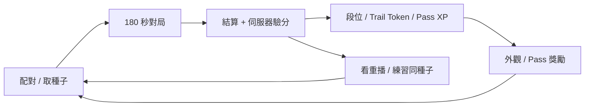

# 01 Core Loop

- **目的**：定義秒→局→日→週→賽季五層循環與玩家動機
- **相關系統**：02 核心玩法、06 經濟、07 變現、08 進度
- **狀態**：Draft

## 設計意圖（Why）

技巧遊戲的回訪動機是「我可以更好」而非「我的數值更高」。所以中長期循環以**排名、段位、外觀**驅動，數值養成只存在於練習模式（Adventure），不進排位。

## 五層循環

| 層 | 時長 | 玩家在做什麼 | 回饋 | 動機 |
|---|---|---|---|---|
| 秒 | 1–5 s | 走位拉怪、衝刺穿怪、撿 Ecto 球 | 擊殺數跳動、Combo 倍率 | 心流 |
| 局 | 180 s | 選升級路線、抓 Howl 時機、撐過頭目 | 分數、排名、對手比分 | 勝負 |
| 日 | 10–20 min | 3–6 場對戰 + 1 次 Daily Seed | 每日任務、Trail Token | 習慣 |
| 週 | — | 週末錦標賽、段位推進 | 錦標賽獎盃、外觀 | 社交比較 |
| 賽季 | 6 週 | Camp Pass、段位重置 | 賽季限定外觀、稱號 | 收藏、炫耀 |

## 模式

| 模式 | 種子 | 配置 | 數值養成 | 用途 |
|---|---|---|---|---|
| Practice | 任意 / 回放種子 | 自由 | 無 | 練習、看高手重播 |
| Adventure | 隨機 | 自由 | 有（永久強化） | 新手留存、PvE 內容 |
| Duel（非同步 1v1） | 對戰共享 | **標準化** | 關閉 | 主要技巧競賽 |
| Tournament（8/16/64 人） | 全場共享 | 標準化 | 關閉 | 週末活動 |
| Daily Seed | 全服共享 | 標準化 | 關閉 | 每日排行榜 |

## Open Questions

- 非同步對戰的對手等待時間上限（建議 24h，逾時退還參賽券）
- 是否加入即時 1v1（同畫面雙營地）—— 網路成本高，先不做
